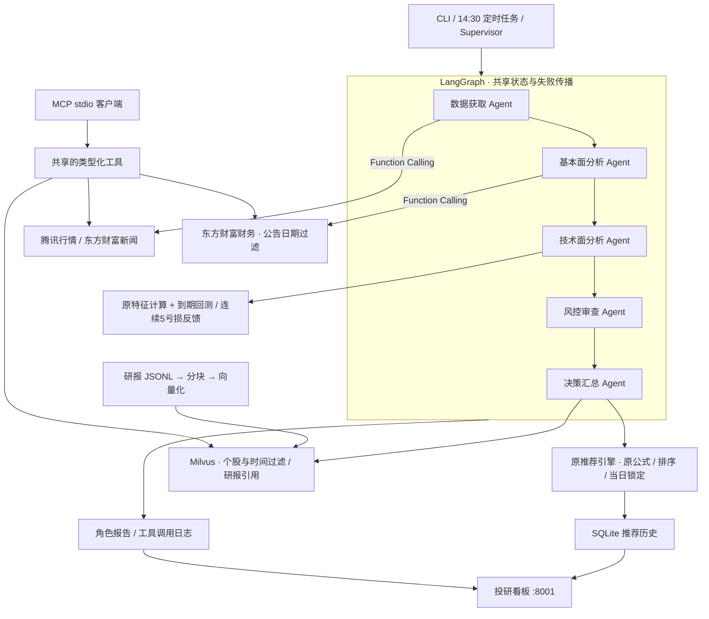
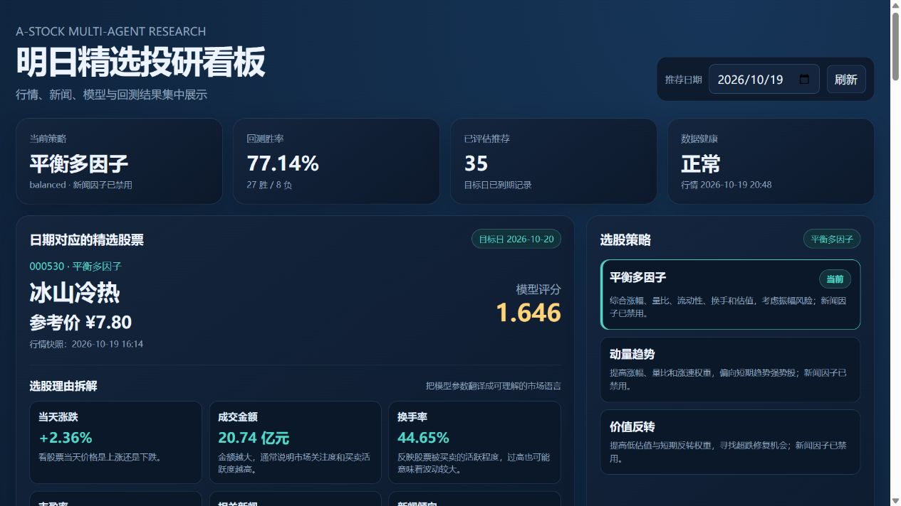
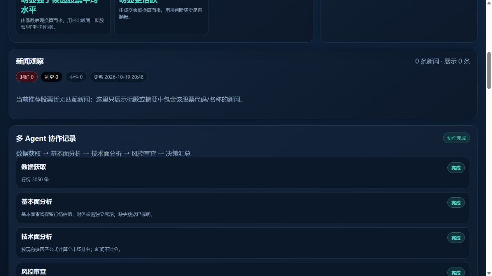
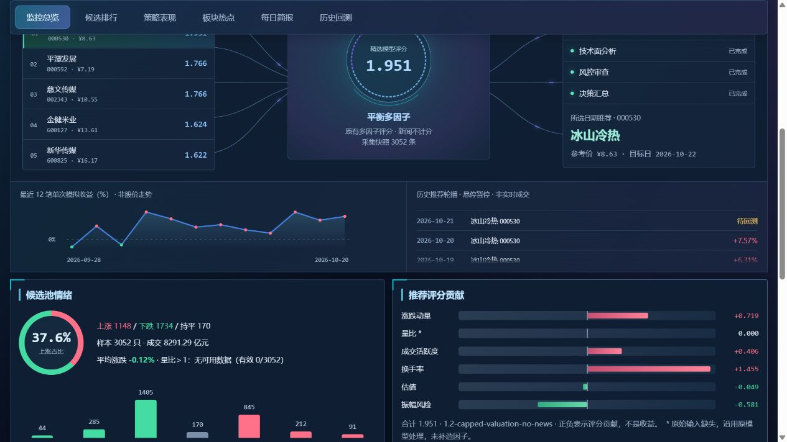

# A 股多 Agent 智能分析系统

## Harness 运行底座

当前采用计划工具驱动的分层 Harness：`harness/planning` 定义步骤与验收，`runtime` 执行和复用检查点，`gateway` 校验工具与归档调用，`policy` 控制恢复，`control` 协调主模型，`adapters` 适配模型协议，`evaluation` 离线核对轨迹。现有正式选股规则和业务数据库不变。

查看执行步骤：`.venv/Scripts/python.exe -m a_stock_agents.cli plan formal`（也支持 `shadow`、`intraday`）。管理员“主Agent”弹框可查看实际计划和任务。完整架构、恢复入口、配置与清理记录见 [Harness说明](docs/harness.md)。

项目使用 **LangGraph StateGraph** 编排数据获取、基本面分析、技术面分析、风控审查、决策汇总五个独立角色。每个角色有独立职责、结构化输入输出、工具权限和运行记录；总控保留重试与故障诊断。行情/财务通过带参数校验的 Function Calling 工具访问，同一套工具通过 MCP stdio 对外提供；研报检索接入 Milvus。

预测继续使用现有 `1.2-capped-valuation-no-news` 多因子模型。财务、研报和可选大模型只提供解释。相同行情、模型状态、配置及当日锁定记录下，推荐结果与升级前一致。

> 风险提示：本项目仅用于数据工程与量化研究，不构成投资建议。公开游客行情可能延迟，不能替代交易所授权行情或券商交易系统。

## 工作流



数据获取角色并行运行原行情和新闻采集器。基本面角色查询三套模型各自领先候选的财务披露；技术面角色运行原特征计算和到期回测，读取反馈后的模型进行排序；风控角色执行原准入、行情时间及数值校验；决策角色调用原推荐引擎并汇总风险和研报证据。采集或关键分析失败会停止推荐。财务/Milvus 不可用时，报告明确显示缺失，不补造数据。

角色默认使用可复现的规则与工具执行；在页面勾选“同时启用各 Agent 大模型解释”并保存后，基本面、技术面、风控、决策角色会分别使用同一套大模型连接配置生成解释。配置文件 `workflow.llm_enabled` 提供默认值。大模型生成的文字不进入股票选择或模型评分；更换服务后请点击“测试连接”确认账户额度可用。

推荐数据以 SQLite 保存到 `runtime/agents/recommendation/data/recommendations.db`。`recommendation_history` 每个推荐日期一条，沿用同日锁定股票及更新锁定股票行情因子的逻辑；`recommendation_realtime` 保存当前快照。旧版 JSONL 仍可幂等迁移。升级和历史快照验证均不重写已有历史推荐。

## 快速开始

要求 Python 3.11+。本次验证使用 Windows Python 3.14。安装 LangGraph、MCP、PyMilvus 等项目依赖：

```powershell
python -m venv .venv
.\.venv\Scripts\Activate.ps1
python -m pip install --index-url https://pypi.org/simple -e .
```

```powershell
$env:PYTHONPATH = (Resolve-Path "src")
python -m a_stock_agents doctor
python -m a_stock_agents run
python -m a_stock_agents status
python -m a_stock_agents model
python -m a_stock_agents web --port 8001
```

启动 `web` 后访问 http://127.0.0.1:8001/，可查看每日推荐股票、推荐日期、当前选股策略、历史推荐和回测胜率。页面直接读取 `runtime/` 中的推荐、回测和总控健康报告，不需要安装前端依赖。

页面的“投研问答”支持询问当天推荐原因、主要因子和风险。默认使用本地规则解释；如需连接大模型，可在页面“大模型连接配置”中填写 OpenAI-compatible 接口地址、模型名和 API Key，或提前设置 `ASTOCK_LLM_API_KEY` 环境变量，再勾选启用并保存。密钥仅保存在本机 `runtime/state/llm_config.json`（页面不会回显），请勿把该文件提交到 Git 或暴露到公网。

也可只运行某个 Agent：

```powershell
python -m a_stock_agents agent market
python -m a_stock_agents agent news
```

开发安装后可以使用 `a-stock-agents run`：

```powershell
python -m pip install -e .
a-stock-agents run
```

运行测试：

```powershell
$env:PYTHONPATH = (Resolve-Path "src")
python -m unittest discover -s tests -p "test_*.py" -v
```

## 数据口径

行情 Agent 使用腾讯财经公开 A 股报价接口，保存原始响应与 CSV 快照。默认执行以下过滤：

- 名称含 `ST` 或 `*ST` 的股票；
- 代码以 `300`、`301` 开头的创业板股票；
- 代码以 `4`、`8`、`92` 开头的北交所股票；
- 非沪深 A 股代码段。

科创板 `688`、`689` 同样排除，推荐端也再次执行板块校验。系统记录报价时间，不能只凭文件修改时间判断行情日期。

新闻 Agent 使用东方财富官方实时快讯接口，聚合 7×24、上市公司和中国股市三个栏目，按 `sortEnd` 游标逐页获取并独立容错。国内新闻按东方财富 `stockList`、A 股代码、市场术语和上市公司事件识别；海外新闻只有命中美联储与全球利率、人民币与中国资产、对华贸易政策、大宗商品、全球供应链或地缘风险等 A 股传导主题时才保留。每条记录包含 `region`、`feed`、`stock_codes`、`relevance_score` 和 `relevance_tags`，原始响应按栏目保存，并向 `news_archive.jsonl` 增量去重归档。看板“新闻观察”只展示与当前推荐股票代码或名称匹配的东方财富实时新闻。回看窗口、栏目、分页数和最低相关性分数可在 [config/settings.json](config/settings.json) 调整。

## 推荐模型与回测反馈

首版内置三套透明、可审计的横截面多因子模型：

- `balanced`：动量、量比、流动性、换手和估值的平衡组合；
- `momentum`：更重视涨幅、量比和涨速；
- `value_reversal`：更重视相对低估值与短期反转。

从模型版本 `1.1-no-news` 起，三套模型均禁用新闻情绪加减分，其余因子权重保持原值，不重新归一化。新闻抓取和页面“新闻观察”继续保留，新闻仅供阅读。新生成或正常刷新评分的推荐会保存 `basis.news_factor_enabled=false` 和对应模型版本；已有历史推荐不自动重算，当天已锁定的股票也不会因本次修改自动更换。

推荐前排除成交额不足以及接近涨跌停的标的。模型、版本、分数和依据随结果保存。模拟回测收益＝`(目标日最高价 / 前一交易日收盘价 - 1) × 100% - 1个百分点`，收盘后判定。只有连续 5 条亏损才按配置轮换模型，保留原反馈逻辑。此指标不是实际成交收益。

## 运行目录

```text
runtime/
  agents/
    market/{raw,data,logs}/
    news/{raw,data,logs}/
    analysis/{data,logs}/
    recommendation/{data,logs}/
    backtest/{data,logs}/
    supervisor/logs/events.jsonl
  state/
    health.json
    model_state.json
    run_*.json
  workflows/
    latest.json
    <run_id>.json
    recommendations/<recommendation_id>.json
  agents/fundamental/raw/
```

`latest.*` 供下游 Agent 稳定读取，带时间戳文件用于审计，JSONL 用于追加历史。状态写入采用临时文件原子替换，降低进程中断造成的损坏风险。

## 故障监控与自愈

总控会把异常分类为数据源阻断、上游字段变化、数据不足、状态损坏或未知异常，并执行有限退避重试。重试失败后不会使用历史缓存继续推荐；行情或新闻没有成功拉取到真实数据时，分析和推荐会停止，直到下一次真实数据拉取成功。健康报告会保留全部失败尝试，方便定位问题。模型状态损坏时，系统先把原文件改名为 `*.corrupt_时间.json`，再重建默认状态。

系统刻意不做无限重试、绕过验证码或模拟登录。上游改版时，可从相应 `raw/` 目录取原始响应更新解析器。

## 定时运行

看板服务默认只在周一至周五的 `14:30` 自动运行完整流水线；周六、周日即使启动服务或直接触发总控，也不会抓取当天行情、回测或生成推荐。周五运行后，下次任务会直接安排到周一 `14:30`。Windows 任务计划程序、cron 或 CI 也可调用 `python -m a_stock_agents run`，CLI 总控入口同样带有周末保护。

当前日历识别 2026 年周末及交易所公布的节假日休市；未知年份会要求补充日历，不猜测交易日。启动时早于 14:30 不自动生成当天推荐。

## MCP 与 Function Calling

多Agent影子选股实验已独立接入：正式推荐完成后异步研究候选，四角色可原生调用受限工具、复核并独立选股或弃选，不替换正式推荐。管理员可在“影子实验”菜单开关/启动，所有登录用户可查看实验；事后补跑不计前瞻收益。见 [运行边界、预算和验证](docs/shadow-agents.md)。

新增外部 **Stock Data MCP 客户端**：所有已登录租户与角色均可访问“个股资金、涨停强势、龙虎榜、板块资金”四个菜单。按需查询、10条分页，保留来源、数据日期与查询时间；不改变推荐模型。安装与限制见 [外部 MCP 接入说明](docs/stock-data-mcp.md)。

```powershell
# stdio 服务只能由 MCP 客户端启动，不是 HTTP 网页。
python -m a_stock_agents mcp
# 查看实际编译的图，输出 Mermaid。
python -m a_stock_agents graph
```

安装后也有 `a-stock-mcp` 入口。客户端示例见 [config/mcp.example.json](config/mcp.example.json)；客户端找不到入口时，将 `command` 改为本项目虚拟环境中 `a-stock-mcp.exe` 的绝对路径。

对外工具：`get_quotes(codes)`、`get_financials(code, as_of)`、`search_research(query, code, as_of, limit)`、`sync_research(code, as_of, limit)`。财务使用东方财富 `RPT_LICO_FN_CPD`，保存原始响应，独立校验股票代码和公告日期；日级公告日期不保证盘中分钟级可知性，因此财务仅用于解释，不参与预测。

代码中的 `AgentTools.schemas()` 生成兼容大模型 `tools` 参数的 JSON Schema；`dispatch_function_call()` 执行模型返回的工具调用，经 Pydantic 校验后分派。LangGraph 和 MCP 共用工具实现，不执行模型生成的任意代码。

## Milvus 研报检索增强

本项目已在 Windows Python 3.14 上安装官方 **Milvus Lite 3.2.2**，通过本地 gRPC 服务提供真实向量持久化、检索和过滤。默认 `research.enabled=true`、`auto_start=true`，看板启动或首次检索时自动检查并拉起 `127.0.0.1:19530`，多个入口复用同一进程。数据保存在 `runtime/milvus/`；自动启动固定使用项目目录下的 ASCII 相对路径，兼容 Windows 中文路径中的 FAISS 索引读写。写入使用跨进程锁串行执行，MCP 异步分派阻塞工具，并在主线程预加载向量库原生依赖。

决策角色自动抓取推荐个股近两年的最多 3 篇东方财富公开研报正文，归档 HTML、元数据和发布日期，然后幂等写入 Milvus。目录或正文不可用时记录缺失，不构造研报。只有日期、没有可靠时分的研报保守地从公布日结束后可用。页面“研报知识库”支持查看实际连接状态、获取该股研报、输入问题检索及打开引用原文；切换推荐日期时同步切换股票和时间范围。

当前本地部署适合单机项目和小规模资料库。需要完整 Standalone/分布式部署时，可使用已有 Docker 配置或远程 Milvus。

```powershell
# 常用：看板会自动启动本机 Milvus Lite。
python -m a_stock_agents web --port 8001 --no-refresh-on-start
python -m a_stock_agents research sync --code 600000 --as-of "2026-10-19T14:30:00+08:00"
# 可选：在支持 Docker 的机器上部署 Standalone。
docker compose -f deploy/compose.yaml up -d
# 等健康检查通过后，启用检索配置。
$env:ASTOCK_CONFIG = (Resolve-Path "config/research.example.json")
# 也可连接远程实例；令牌仅使用环境变量。
$env:ASTOCK_MILVUS_URI = "http://127.0.0.1:19530"
# $env:ASTOCK_MILVUS_TOKEN = "..."
python -m a_stock_agents research ingest --file "C:\reports\research.jsonl"
python -m a_stock_agents research search --query "盈利与估值风险" --code 000823 --as-of "2026-10-19T14:30:00+08:00"
```

输入为有真实来源的 UTF-8 JSONL，每行字段为 `code`（六位股票代码，行业报告可为空）、`title`、`source`（来源/URL）、`published_at`（带时区的发布时间）、`text`（正文）。只导入自己有权使用的研报；项目没有内置虚构研报。按 1000 字、800 字步长分块，保留来源和发布时间，使用稳定 ID 幂等 upsert。检索限定股票及截止时间，返回原文片段和引用，不读取未来发布的研报。

默认 `zh-char-bigram-v1` 是本地中文字符二元组哈希向量，便于离线运行，属于词面相似检索。需要语义检索时配置 `research.embedding_base_url`、`embedding_model`、`dimension` 和 `ASTOCK_EMBEDDING_API_KEY`，连接兼容 `/embeddings` 的模型服务。模型或维度变化会使用不同 collection，旧研报需要重新导入。文本生成和向量服务密钥分开配置。

运行 `python tools/verify_milvus.py` 会在独立的合成测试 collection 中验证真实库写入、检索、股票和未来日期过滤，完成后只清理该测试 collection。本次真实测试已通过，见 [milvus_smoke.json](docs/verification/milvus_smoke.json)。数据库重启、自动拉起和重启后研报检索验证见 [milvus_restart.json](docs/verification/milvus_restart.json)。

## 升级一致性验证

本次验证覆盖 **86 份真实历史行情快照 × 3 套原模型＝258 组**，共 **395,079 条候选排名**。实际编译的 LangGraph 回放与原引擎逐条比较代码、价格、未经四舍五入的评分及排序，**258/258 通过**。`models.py` 和 `agents/analysis.py` 的 SHA256 与升级前一致。

对比采用当前模型版本，证明同一输入下升级前后计算一致；不将当前公式重放结果当作旧版本历史实盘推荐。运行报告见 [recommendation_parity.json](docs/verification/recommendation_parity.json)。基线保留在本机 `runtime/upgrade_verification/before.json`，初次基线脚本的过滤顺序修正也单独保留，未修改预测代码来迁就测试。

```powershell
# 原始快照及升级前基线存在时，可以复测全量一致性。
python tools/verify_agent_upgrade.py
# 单次离线回放，不写推荐数据库、不抓取新行情。
python -m a_stock_agents replay --snapshot runtime/research_backtests/close_inputs_20261015_16/2026-10-16.csv --model balanced
# 实际 MCP 客户端握手、发现和工具调用。
python tools/verify_mcp.py --live
python -m unittest discover -s tests -p "test_*.py" -v
```

本次 67 项自动化测试通过；真实 MCP 客户端完成握手、工具发现、腾讯行情、东方财富财务、研报同步及 Milvus 研报检索，6 项联调检查通过，记录见 [mcp_smoke.json](docs/verification/mcp_smoke.json)。`tests/test.py` 是个人联网实验，不属于 `test_*.py` 自动化测试集。

已修复零成交停牌报价时间早于 14:30 时阻断整批推荐的问题：仍对原始完整行情计算标准分，只对符合原有成交额/涨跌幅条件的候选校验报价时间；过期的有效候选和锁定股票仍会被拦截，未改变预测公式、横截面计算或排序。

完整真实流水线已成功运行，健康报告 `ok=true`、`degraded=false`。当前保存的大模型账户实际返回 HTTP 429、余额不足；问答页面会显示最近测试原因，大模型角色解释需要用户充值该账户或在页面换成有额度的兼容服务。行情、选股、回测、规则解释和本地 Milvus 不依赖该账户余额。连接诊断见 [llm_connection.json](docs/verification/llm_connection.json)。

## 运行截图

下图来自本机完整真实流水线运行后的看板，展示实际推荐、健康状态、五角色协作和 Milvus 连接状态。历史快照回放仍独立标注，不会修改历史推荐。





实现参考：[LangGraph Graph API](https://docs.langchain.com/oss/python/langgraph/graph-api)、[MCP Python SDK](https://github.com/modelcontextprotocol/python-sdk)、[Milvus Lite 官方文档](https://github.com/milvus-io/milvus-lite)、[Milvus 官方独立部署脚本](https://github.com/milvus-io/milvus/blob/v2.6.11/scripts/standalone_embed.sh)。

## 菜单式投研工作台

看板新增“监控总览、候选排行、策略表现、板块热点、每日简报、历史回测”六个切换菜单，保留深色动态风格、红盈绿亏和原推荐公式。新增内容包括样本池情绪、因子贡献、候选搜索排序、独立收盘价研究与沪深300对照、行业热力图及有来源的历史研究简报。数据缺口直接展示，不用旧行情或推算结果冒充真实数据。

计算口径、数据来源与更新方式见 [投研工作台说明](docs/research-workspace.md)。收盘价研究与原最高涨幅减一点的回测分开显示，不代表真实成交收益。



## 多租户与三级权限

首次访问页面需在本机设置管理员账号和密码。支持管理员、经理、普通用户：管理员管理所有租户和账号，经理仅创建本租户普通账号，普通用户仅可访问监控总览与每日简报。模型连接按租户隔离；新增管理员专属 Token 统计菜单，按租户、用户、日期展示服务商实际返回的发送/响应用量和分页明细。详见 [登录与多租户说明](docs/multi-tenancy.md)。

## 配置

默认设置位于 [config/settings.json](config/settings.json)。可以复制一份并用 `--config` 指定覆盖配置，也可以设置 `ASTOCK_CONFIG` 环境变量。自定义 JSON 会与默认配置递归合并。

### 腾讯行情主源与东方财富备选实现

默认行情源为腾讯财经 `qt.gtimg.cn`，先获取每日更新的 A 股代码清单，再以短 URL 分批查询实时行情；代码清单会缓存到本地，因此清单服务短暂不可用时仍可继续运行。系统要求报价覆盖率达到配置阈值后才覆盖 `latest.csv`。东方财富 `push2` 的解析、节点轮换、大页抓取和断点续传实现仍保留，将 `provider` 改为 `eastmoney` 即可切回。
